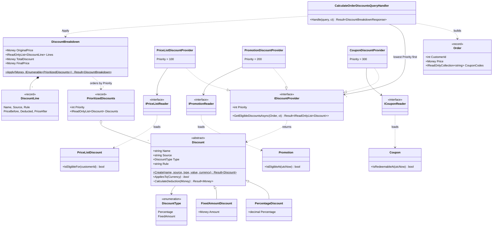
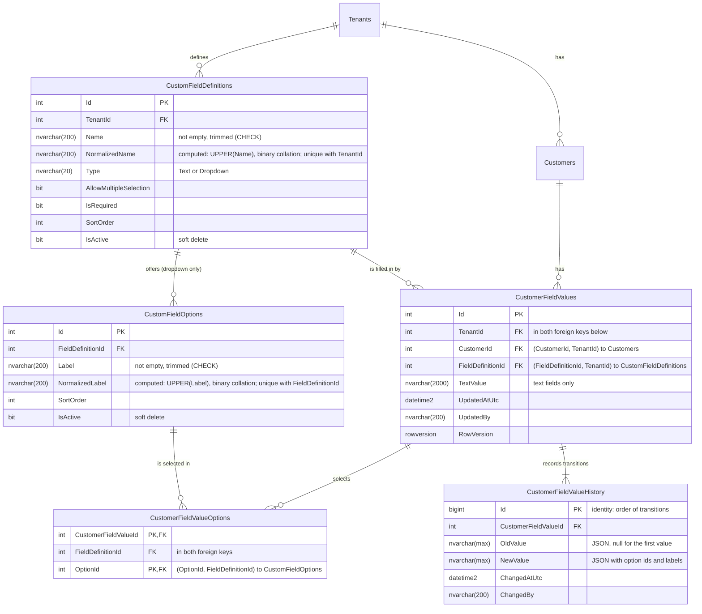

# Subscription Commerce: discount engine and dynamic customer fields

Back-end take-home for Infiterra. One .NET 10 API, SQL Server, two modules:

- **Pricing** (Topic 1): the discount logic taken out of the stored procedure into a testable engine. Price list, promotion and coupon discounts are applied in priority order to a running price, and the result is a breakdown plus the final price.
- **Customers** (Topic 2): users define custom fields (text or dropdown) for customer profiles, values are stored per customer, and every change keeps its history.

Both topics come with diagrams and runnable, tested code.

- [How to run](#how-to-run)
- [Assumptions](#assumptions)
- [Architecture](#architecture)
- [Topic 1: discount engine](#topic-1-discount-engine)
- [Topic 2: dynamic customer fields](#topic-2-dynamic-customer-fields)
- [Module communication](#module-communication)
- [Tests](#tests)
- [Next steps](#next-steps)

## How to run

You need Docker Desktop, and the .NET 10 SDK to build and test outside Docker.

```bash
docker compose up -d --build
```

This builds the API image (`src/API/SubscriptionCommerce.Api/Dockerfile`) and starts it with SQL Server, Seq and Jaeger. The API waits for SQL Server's healthcheck, runs in the Development environment (`docker-compose.override.yml`), and applies the EF Core migrations on start, which also seeds the Topic 1 example data.

In Visual Studio, set `docker-compose` as the startup project: its "Docker Compose" profile starts the same stack and attaches the debugger to the API container. The `.dcproj` builds as a no-op with the plain .NET SDK, so `dotnet build` works without Visual Studio.

To run or debug the API outside Docker instead, start only the infrastructure and run the project. Its `http` launch profile points the connection string, Seq and Jaeger at `localhost`; inside Docker, `appsettings.Development.json` uses the compose service names.

```bash
docker compose up -d subscriptioncommerce.database subscriptioncommerce.seq subscriptioncommerce.jaeger
dotnet run --project src/API/SubscriptionCommerce.Api
```

| What | Where |
|---|---|
| API and Swagger UI | http://localhost:5000/swagger |
| Seq (logs) | http://localhost:8081 |
| Jaeger (traces) | http://localhost:16686 |
| SQL Server | `localhost,1433`, user `sa`, password in `docker-compose.yml` (local container only) |

Run the tests:

```bash
dotnet test SubscriptionCommerce.slnx
```

The Pricing and Customers integration tests each start their own SQL Server container through Testcontainers, so Docker must be running. The first run pulls the SQL Server image and takes a few minutes.

### Try Topic 1

The seed gives customer 1 the brief's example: a 5% price list discount, a 10% promotion and the coupon `WELCOME10` worth 10 EUR.

```bash
curl -X POST http://localhost:5000/orders/discounts \
  -H "Content-Type: application/json" \
  -d '{"customerId": 1, "price": 340, "currency": "EUR", "couponCodes": ["welcome10"]}'
```

Expected response, shortened:

```json
{
  "originalPrice": 340,
  "currency": "EUR",
  "discounts": [
    { "name": "Gold price list",  "source": "PriceList", "type": "Percentage",  "rule": "5%",        "priceBefore": 340,    "deducted": 17.00, "priceAfter": 323.00 },
    { "name": "Autumn promotion", "source": "Promotion", "type": "Percentage",  "rule": "10%",       "priceBefore": 323.00, "deducted": 32.30, "priceAfter": 290.70 },
    { "name": "Welcome coupon",   "source": "Coupon",    "type": "FixedAmount", "rule": "10.00 EUR", "priceBefore": 290.70, "deducted": 10.00, "priceAfter": 280.70 }
  ],
  "totalDiscount": 59.30,
  "finalPrice": 280.70
}
```

### Try Topic 2

The caller names itself in the `X-User-Name` header (see [Assumptions](#assumptions)). Each `POST` returns the new id.

```bash
curl -X POST http://localhost:5000/tenants -H "Content-Type: application/json" -d '{"name": "Contoso Distribution"}'
curl -X POST http://localhost:5000/tenants/1/customers -H "Content-Type: application/json" -d '{"name": "Fabrikam"}'
curl -X POST http://localhost:5000/tenants/1/fields -H "Content-Type: application/json" -H "X-User-Name: maria" \
  -d '{"name": "Industry", "type": "Dropdown", "allowMultipleSelection": false}'
curl -X POST http://localhost:5000/tenants/1/fields/1/options -H "Content-Type: application/json" -d '{"label": "Education", "sortOrder": 0}'

# First value: no row version yet. The response carries the new one.
curl -X PUT http://localhost:5000/tenants/1/customers/1/fields/1/value -H "Content-Type: application/json" -H "X-User-Name: maria" \
  -d '{"selectedOptionIds": [1]}'

curl http://localhost:5000/tenants/1/customers/1/profile
curl "http://localhost:5000/tenants/1/customers/1/fields/1/history?limit=50"
```

To change a value later, send the `rowVersion` from the profile or from the last response. A stale one gets `409 Conflict`. History comes a page at a time: pass the response's `nextAfter` as `after` to get the next page; it is `null` on the last one.

### Adding a migration

Migrations are generated by EF Core and never written by hand:

```bash
dotnet ef migrations add <Name> \
  --project src/Modules/Customers/SubscriptionCommerce.Modules.Customers.Infrastructure \
  --startup-project src/API/SubscriptionCommerce.Api \
  --context CustomersDbContext --output-dir Database/Migrations
```

Run it with `ASPNETCORE_ENVIRONMENT=Development` so the tool finds the connection string. For Pricing, swap the project and use `--context PricingDbContext`.

## Assumptions

1. **Tenants and customers stand in for existing ERP tables.** The API can create them only so that fields and discounts have something to attach to. A customer is just `Id`, `TenantId` and `Name`.
2. **The logged-in user is a header, and the tenant is the route.** `ICurrentUser` reads `X-User-Name` and falls back to `anonymous`; a name longer than the 200-character audit columns is rejected with 400. Every tenant-owned resource lives under `/tenants/{tenantId}/...`, and customers and fields are only ever looked up within that tenant. Real authentication is out of scope: with it, the user and the tenant would come from the token, and a caller could no longer pick any tenant id.
3. **"Dropdown with multiple selectable values" is ambiguous**, so both readings are supported: `AllowMultipleSelection` makes a dropdown single- or multi-select. A text field can't be multi-select.
4. **Price list discounts belong to one customer; promotions apply to everyone** while active and inside `[StartsAtUtc, EndsAtUtc)`; a coupon applies when the customer entered its code and it is active and not expired.
5. **Unknown, inactive or expired coupon codes are skipped**, not reported as errors. Codes are trimmed, compared case-insensitively and counted once.
6. **Every eligible discount is applied.** Stacking rules, exclusivity and caps are out of scope (see [Next steps](#next-steps)).
7. **`price` is the amount eligible for discounts** (the brief's "340 € per 6 months"). Billing periods are not modelled.
8. Pricing refers to customers by the ERP's customer id. It does not reference the Customers module.
9. **Currencies are a deliberate, two-decimal scope.** `Currency` accepts a fixed list of ISO 4217 codes that all have two decimal places (EUR, USD, GBP, CHF, SEK, NOK, DKK, PLN, CZK); any other code is rejected with 400 `Money.CurrencyNotSupported`. One constant, `Currency.DecimalPlaces`, drives rounding, request validation, discount precision and the database columns. Supporting JPY (0) or BHD (3) would mean storing the minor units per currency and using them in each of those places.
10. **Within one source, discounts apply in the order the ERP created them** (by id). The order matters (10% then −10 € is not −10 € then 10%), and the brief gives no rule for it, so creation order is the stated, tested choice. A business rule would replace it with an explicit sort column.

## Architecture

### Modular monolith

The two topics have nothing in common, but they ship as one API with one database. A modular monolith keeps that simple to run and test, while each module stays separable:

- each module has its own Domain, Application, Infrastructure and Presentation projects, its own SQL Server schema (`pricing`, `customers`) and its own migrations history table;
- modules never reference each other, and `Common` never references a module;
- inside a module, dependencies point inward (Presentation → Application → Domain, Infrastructure → Application → Domain), and EF Core appears only in Infrastructure;
- only the API composition root sees both outer layers: it registers each module's Infrastructure and discovers its endpoints in the Presentation assemblies, so Infrastructure never references Presentation;
- commands load and save aggregates through repositories, while queries go through read interfaces (`ICustomerProfileReader`, `IFieldValueHistoryReader`, the Pricing readers) that Infrastructure implements with EF Core `AsNoTracking`.

Architecture tests (NetArchTest) fail the build when any of these rules breaks: `PricingModule_Should_NotHaveDependencyOn_CustomersModule`, `CustomersModule_Should_NotHaveDependencyOn_PricingModule`, `Common_Should_NotHaveDependencyOn_AnyModule`, `DomainLayer_Should_NotHaveDependencyOn_OuterLayers`, `ApplicationLayer_Should_NotHaveDependencyOn_PresentationOrInfrastructure`, `PresentationLayer_Should_NotHaveDependencyOn_Infrastructure`, `InfrastructureLayer_Should_NotHaveDependencyOn_Presentation` and `DomainAndApplicationLayers_Should_NotHaveDependencyOn_EntityFrameworkCore`. NetArchTest only sees references that compiled types use, so `ProjectReferences_Should_FollowTheLayerGraph` also reads every `.csproj` and checks each `<ProjectReference>` against the allowed layer graph, which catches a reference nobody uses yet.

The structure follows the developer's earlier "evently" modular monolith, trimmed to what this brief needs.

```text
src/
  API/SubscriptionCommerce.Api                  composition root: Serilog, OpenTelemetry, Problem Details, Swagger
  Common/SubscriptionCommerce.Common.Domain          Result, Error, Money, Currency
         SubscriptionCommerce.Common.Application     ICommand/IQuery handlers, decorators, ICurrentUser
         SubscriptionCommerce.Common.Infrastructure  TimeProvider, header user, OpenTelemetry setup
         SubscriptionCommerce.Common.Presentation    IEndpoint, Result -> Problem Details
         SubscriptionCommerce.Common.UnitTests
  Modules/Pricing/SubscriptionCommerce.Modules.Pricing.{Domain,Application,Infrastructure,Presentation,UnitTests,IntegrationTests}
  Modules/Customers/SubscriptionCommerce.Modules.Customers.{Domain,Application,Infrastructure,Presentation,UnitTests,IntegrationTests}
test/
  SubscriptionCommerce.ArchitectureTests
diagrams/                                        class diagram, ER diagram, module communication flows
```

### Request pipeline

Each endpoint is an `IEndpoint` class that sends a command or query to its handler. Handlers are found by assembly scanning (Scrutor) and wrapped in three decorators, which run in this order: exception handling, logging (with the module and request name on the trace), and FluentValidation. Validators run one after another, each with its own validation context, so they never share mutable state and their failures come back in a fixed order (`Handle_Should_RunValidatorsOneAfterAnother_AndReportEveryFailureInOrder`). Handlers return `Result`. Expected failures are values, not exceptions, and map to RFC 7807 Problem Details with the error code as the title:

| Error type | Status | Example |
|---|---|---|
| Validation, Problem | 400 | `CustomFields.Inactive` (`Should_RejectValueChanges_AfterTheFieldIsDeactivated`) |
| NotFound | 404 | a field of another tenant (`Should_Return404_ForAFieldOfAnotherTenant`) |
| Conflict | 409 | a stale row version (`Should_Return409ProblemDetails_WhenTheRowVersionIsStale`) |
| Failure, unhandled exception | 500 | the database is down |

A request the client cancels is not a failure. When the caller's token is cancelled, the exception decorator lets the `OperationCanceledException` through unwrapped and ASP.NET Core ends the request as aborted, instead of logging a server error and answering 500. A cancellation the caller didn't ask for, such as a database timeout, is still logged and wrapped (`Handle_Should_LetTheCancellationThrough_WhenTheCallerCancelled`, `Handle_Should_WrapACancellation_TheCallerDidNotAskFor`, for all three decorator variants).

Naming and visibility conventions (sealed commands and queries, internal sealed handlers and validators) are architecture tests too (`ApplicationTests`).

### Logging and tracing

Serilog writes structured logs to the console and Seq, with the trace id on every request. OpenTelemetry traces ASP.NET Core, outgoing HTTP and EF Core, and exports over OTLP to Jaeger, so one request shows up as a trace with its SQL statements.

### What was left out, and when it would come back

| Left out | Why not now | When it comes back |
|---|---|---|
| Dapper | EF Core `AsNoTracking` projections cover every read here; one data-access technology is easier to defend | A hot read path where the exact SQL matters |
| Message bus, outbox/inbox, integration events | The modules don't talk to each other | When one module must react to another's changes, or one is deployed on its own ([flow 4b](diagrams/module-communication.md#4b-asynchronous-through-an-integration-event-if-pricing-were-deployed-separately)) |
| Domain events | Field history is part of the aggregate and saved in the same transaction; nothing else reacts | Together with the outbox |
| Authentication and permissions (Keycloak/JWT) | Out of scope for the brief | Before any real use; the tenant would then come from the token |
| Redis caching | No hot read path | If loading promotions per calculation becomes a bottleneck |
| Scheduled jobs, health checks | Nothing scheduled; no orchestrator to probe the API | With a real deployment |

## Topic 1: discount engine

### Design

Two ideas are kept apart:

- The **source** (price list, promotion, coupon) decides the priority and how eligibility is found. Each source is one `IDiscountProvider` in the Application layer, with a `Priority` (100, 200, 300; the gaps leave room for new sources) and `GetEligibleDiscountsAsync(order)`. The data comes through a reader interface (`IPriceListReader`, `IPromotionReader`, `ICouponReader`) implemented with EF Core in Infrastructure, and a provider could just as well call another service. The eligibility rules belong to the domain entities the readers return: `PriceListDiscount.IsEligibleFor(customerId)`, `Promotion.IsEligibleAt(utcNow)` and `Coupon.IsRedeemableAt(utcNow)`. The provider loads, keeps what is eligible and turns it into `Discount`s. Those entities are read models of ERP rows: EF Core loads them without calling their factories, so the provider is the boundary that validates them. One rule decides what bad ERP data does: a row that can never apply never breaks pricing, and a row that would apply but is invalid fails the calculation as a server-side error, so no wrong discount is ever given. The readers load only rows that could apply (active price list discounts; active promotions that haven't ended; active, unexpired coupons the customer entered), so a broken inactive or expired row is never even read; the domain methods still make the final eligibility decision. An active promotion that ends before it starts can never run, so it is skipped and logged as a warning.
- The **calculation** (percentage or fixed amount) is a subclass of the abstract `Discount` in the Domain: `PercentageDiscount` holds a percentage, `FixedAmountDiscount` holds a `Money`. Each one owns its validation, its rule text, which currencies it applies to and how it computes the deduction, so there is no switch on the type outside the one factory. `Discount.Create` checks what both share (name, source, two decimals) and picks the subclass, so the arithmetic never sees an invalid discount. A new calculation type is one new subclass and one line in that factory. The constructor is `private protected`, so only the Domain can add one (`Create_Should_BuildAPercentageDiscount_ForAPercentage`, `Create_Should_HoldAFixedAmountAsMoney`, `Discount_Should_OnlyBeSubclassedInsideTheDomain`).

`CalculateOrderDiscountsQueryHandler` builds the `Order` (customer, price as `Money`, normalized coupon codes), calls the providers one after another in priority order, and passes each source's discounts, together with that source's priority, to `DiscountBreakdown.Apply`. The domain orders the sources by priority itself, so no caller can apply them in the wrong order. The calls are sequential on purpose: the providers share the request's `DbContext`, which is not thread-safe. The handler keeps only the discounts that apply to the order's currency (`Discount.AppliesTo`): a percentage applies to any price, a fixed amount only to a price in its own currency. This is checked once in the handler, not in each provider, so a new source can't forget it. `DiscountBreakdown` is pure: it takes each discount off the running price and records one line per discount. `Lines` is a read-only wrapper, so no caller can change the lines that `TotalDiscount` and `FinalPrice` were calculated from (`Lines_Should_RefuseChanges_EvenWhenCastBackToAList`).



The full diagram, with layers and the EF Core readers, is in [diagrams/discount-engine.mmd](diagrams/discount-engine.mmd). The request flow is [flow 2](diagrams/module-communication.md#2-calculate-discounts-inside-pricing).

### Adding a source

A loyalty discount is one new provider class (plus its reader and table, like the other three):

```csharp
internal sealed class LoyaltyDiscountProvider(ILoyaltyReader reader) : IDiscountProvider
{
    internal const string Source = "Loyalty";

    public int Priority => 150; // after the price list, before promotions

    public async Task<Result<IReadOnlyList<Discount>>> GetEligibleDiscountsAsync(Order order, CancellationToken cancellationToken)
    {
        // read, filter for eligibility, Discount.Create(...) for each
    }
}
```

Providers are registered by scanning, and the handler and the domain don't change. `Handle_Should_ApplyANewSource_WithoutChangingTheHandler` slots a loyalty provider in at priority 150, and `AddPricingModule_Should_RegisterEveryDiscountProviderWithAUniquePriority` proves the scan picks up every provider. Two providers with the same priority would apply in an order nobody chose, so the API refuses to start: a hosted check resolves the providers once at startup (`Startup_Should_Fail_WhenTwoProvidersShareAPriority`, `Startup_Should_Succeed_WithTheRegisteredProviders`).

### Money rules

| Rule | Test |
|---|---|
| The brief's example: 340 → −17.00 → −32.30 → −10.00, total 59.30, final 280.70 | `Apply_Should_MatchTheBriefExample` |
| Each discount applies to the running price, not the original | `Apply_Should_ApplyEachDiscountToTheRunningPrice` |
| Each line is rounded to cents with `MidpointRounding.AwayFromZero` (0.025 → 0.03) | `Apply_Should_RoundEachLineToCentsAwayFromZero` |
| A discount value has at most two decimals, like its column, so the rule shown in the breakdown is exactly what was calculated | `Create_Should_Fail_WhenTheValueHasMoreThanTwoDecimals`, `Create_Should_ShowTheFullPrecisionInTheRule` |
| Only the supported two-decimal currencies are accepted | `Create_Should_AcceptASupportedCurrency_IgnoringCaseAndSpaces`, `Create_Should_Fail_WhenTheCurrencyIsNotSupported`, `Create_Should_Fail_WhenTheCodeIsNotThreeLetters` |
| A fixed amount larger than the remaining price takes it to 0, never below | `Apply_Should_CapFixedAmount_WhenItIsLargerThanTheRemainingPrice` |
| A fixed amount applies only to an order in its own currency and is never converted; in another currency it is skipped, like an expired coupon, and the other discounts still apply | `AppliesTo_Should_MatchFixedAmountsOnlyToTheirOwnCurrency`, `Handle_Should_SkipFixedAmountsInAnotherCurrency_AndApplyTheRest` |
| `DiscountBreakdown` still refuses to mix currencies, as an invariant the handler never reaches | `Apply_Should_Fail_WhenFixedAmountCurrencyDiffersFromThePrice` |
| A percentage must be greater than 0 and at most 100 | `Create_Should_Fail_WhenPercentageIsOutOfRange`, `Create_Should_AcceptOneHundredPercent` |
| A fixed amount must be positive and have a valid ISO currency; a percentage has no currency | `Create_Should_Fail_WhenFixedAmountIsNotPositive`, `Create_Should_Fail_WhenAFixedAmountHasNoCurrency`, `Create_Should_Fail_WhenPercentageHasACurrency` |
| Sources apply in priority order, whatever order they were registered in or handed to the domain | `Handle_Should_ApplyProvidersInPriorityOrder_RegardlessOfRegistrationOrder`, `Apply_Should_ApplySourcesInPriorityOrder_WhateverOrderTheyArriveIn` |
| Several discounts from one source keep that source's order, which is creation order for the ERP sources; the order changes the price | `Handle_Should_KeepTheProvidersOwnOrder_WhenOneSourceReturnsSeveralDiscounts`, `PriceList_Should_ReturnDiscountsInCreationOrder_WhateverOrderTheReaderReturns`, `Apply_Should_KeepTheOrderWithinASource_BecauseItChangesThePrice` |
| A failing provider fails the whole calculation; no partial price is returned | `Handle_Should_FailWithoutAPartialPrice_WhenAProviderFails`, `Handle_Should_LetExceptionsPropagate_WhenAProviderThrows` |
| Stored data that would apply but breaks the rules is a server-side failure, not a client error, and never a wrong discount | `PriceList_Should_Fail_WhenAStoredDiscountIsInvalid`, `Should_Return500_WhenAnEnteredCouponIsStoredInAnUnsupportedCurrency` |
| A row that can never apply never breaks pricing: inactive, expired and ended rows aren't read, even with a currency the domain rejects | `Should_IgnoreAnInactivePriceListRow_StoredInAnUnsupportedCurrency`, `Should_IgnoreAnExpiredCoupon_StoredInAnUnsupportedCurrency`, `Should_KeepPricingOrders_WhenAPromotionCanNeverApply` |
| The example holds end to end, through the API and the seeded SQL Server tables | `Should_ApplyTheBriefsExample_ToTheSeededCustomer` |
| Through the API, a EUR coupon on a USD order is skipped and the order is still priced (200) | `Should_SkipACouponInAnotherCurrency_AndStillPriceTheOrder` |
| The request is validated before any provider runs: positive customer id, a price that is not negative and has at most two decimals, a three-letter currency, coupon codes that are not empty and at most 50 characters | `CalculateOrderDiscountsQueryValidatorTests` (for example `Validate_Should_Fail_WhenThePriceHasMoreThanTwoDecimals`) |

Amounts are `decimal` throughout, wrapped in `Money` with a `Currency` from the shared kernel.

### Eligibility rules

| Rule | Test |
|---|---|
| A price list discount applies to its own customer, only while active | `PriceListDiscount_Should_BeEligible_OnlyWhenActiveAndForItsCustomer`, `PriceList_Should_ReturnOnlyEligibleDiscounts` |
| A promotion applies from `StartsAtUtc` (inclusive) to `EndsAtUtc` (exclusive), only while active | `Promotion_Should_BeEligible_OnlyWhileActiveInsideItsWindow`, `Promotion_Should_ReturnOnlyPromotionsRunningNow` |
| An active promotion that ends before it starts can never run: it is skipped and logged as a warning, and every other discount still applies; an inactive one is ignored | `Promotion_Should_SkipAndLog_AnActivePromotionThatEndsBeforeItStarts`, `Promotion_Should_IgnoreABadWindow_OnAnInactivePromotion`, `Should_KeepPricingOrders_WhenAPromotionCanNeverApply` |
| A coupon applies while active and before it expires; without an expiry date it never expires | `Coupon_Should_BeRedeemable_OnlyWhileActiveAndNotExpired`, `Coupon_Should_NeverExpire_WithoutAnExpiryDate`, `Coupon_Should_SkipInactiveAndExpiredCoupons` |
| No coupon codes on the order, no database call | `Coupon_Should_NotQueryTheReader_WhenTheOrderHasNoCodes` |
| Coupon codes are trimmed, upper-cased and de-duplicated before the providers see them | `Handle_Should_PassNormalizedCouponCodesToProviders` |
| The EF Core readers return the right rows from SQL Server, and the rules above hold on real data | `Should_ReadOnlyTheCustomersActivePriceListDiscounts`, `Should_SkipPromotionsThatAreInactiveExpiredOrNotStartedYet`, `Should_ApplyOnlyActiveUnexpiredCouponsTheCustomerEntered` |

Time comes from an injected `TimeProvider`, so the tests fix "now".

### Data

Three tables in the `pricing` schema stand in for the data the stored procedure queried: `PriceListDiscounts` (per customer), `Promotions` and `Coupons` (unique `Code`). EF Core maps them straight onto `PriceListDiscount`, `Promotion` and `Coupon`, which are read models: read-only from this module's point of view, loaded without their factories, and validated by the providers on the way into a `Discount`. The one exception is the currency column: a value converter (`CurrencyConverter`) turns it into the `Currency` value object as the row is read, through `Currency.Create`, so the read models never hold an unchecked code. A stored code the domain doesn't accept stops the read with an exception that names it, which the API answers with 500. Because the readers only load rows that could apply, that can only happen for a row that would otherwise have been used. They are seeded with the example through the migration.

### Moving off the stored procedure

The goal is to switch without anyone noticing a different price.

1. **Characterization tests first.** Run the current stored procedure over a representative set of real orders (each source alone, combinations, fixed amounts larger than the price, prices that hit a rounding midpoint) and keep the results as expected outputs. Run the engine against the same inputs until both agree. `AwayFromZero` was chosen because it is how T-SQL `ROUND` treats decimals; these tests confirm or correct that.
2. **Shadow mode.** In production, keep charging the stored procedure's price and compute the engine's breakdown alongside it. Log every difference with the order id to Seq, and fix the cause until differences stop.
3. **Feature-flagged cutover.** Switch to the engine behind a flag, per tenant or by percentage, while the stored procedure still runs for comparison. Rolling back is turning the flag off.
4. **Remove the stored procedure's discount logic last**, once the flag has been fully on for at least one full billing cycle without differences.

## Topic 2: dynamic customer fields

### Data model



The full diagram, with every column, is in [diagrams/dynamic-fields-er.mmd](diagrams/dynamic-fields-er.mmd). It matches the generated migration in `src/Modules/Customers/SubscriptionCommerce.Modules.Customers.Infrastructure/Database/Migrations`.

The database enforces tenant isolation and option ownership itself, not only the handlers. `CustomerFieldValues` carries the `TenantId`, and its foreign keys are `(CustomerId, TenantId)` and `(FieldDefinitionId, TenantId)`, pointing at alternate keys `(Id, TenantId)` on `Customers` and `CustomFieldDefinitions`. So a value can't join a customer of one tenant to a field of another. `CustomerFieldValueOptions` carries the `FieldDefinitionId`, and its foreign keys are `(CustomerFieldValueId, FieldDefinitionId)` and `(OptionId, FieldDefinitionId)`. So a selected option must belong to the value's field. The extra columns exist only for these constraints; a future import job, SQL script or new handler can't write inconsistent rows.

There are two aggregates. `CustomFieldDefinition` owns its options and their rules (unique label, dropdown only, soft delete). `CustomerFieldValue` owns its selected options **and its history**: a change and its history entry are added together and saved in one `SaveChanges`. History is not sent through domain events or an outbox. The aggregate only ever holds the entries added since it was loaded (`PendingHistory`); the full history is read through `IFieldValueHistoryReader`. `Options`, `SelectedOptions` and `PendingHistory` are read-only wrappers over private lists, which EF Core reads and writes directly, so no caller can cast one back and, say, drop a pending history entry or rewrite its snapshot (`Collections_Should_RefuseChanges_EvenWhenCastBackToACollection`, `Options_Should_RefuseChanges_EvenWhenCastBackToACollection`).

A value depends on its field's metadata (type, required, selection policy, active state, options) but never holds the field. `CustomerFieldValue.Change` takes `FieldValueRules`, an immutable copy that `CustomFieldDefinition.ValueRules()` makes when the change starts, so the signature shows exactly what the value depends on (`ValueRules_Should_BeACopy_ThatLaterChangesToTheFieldDoNotAffect`). Its constructor is internal to the domain and its options are an `ImmutableArray`, so the application can pass rules along but can't fabricate them, for example claim that a dropdown is a text field (`ValueRules_Should_HaveNoPublicConstructor_SoOnlyTheFieldCanCreateThem`).

The entities guard their own invariants: `Tenant`, `Customer`, `CustomFieldDefinition` and options reject missing or over-long names and labels, `CustomerFieldValue` rejects text longer than its column, and every audit column is written from a `UserName` value object that is at most 200 characters. The request validators only check the shape of the input: positive ids and the row-version format.

### Endpoints

| Method and path | What it does |
|---|---|
| `POST /tenants` | Create a tenant |
| `POST /tenants/{tenantId}/customers` | Create a customer |
| `POST /tenants/{tenantId}/fields` | Create a field: `name`, `type` (`Text` or `Dropdown`), `allowMultipleSelection`, `isRequired`, `sortOrder` |
| `POST /tenants/{tenantId}/fields/{fieldId}/options` | Add a dropdown option |
| `PUT /tenants/{tenantId}/fields/{fieldId}/options/{optionId}` | Rename an option |
| `PUT /tenants/{tenantId}/fields/{fieldId}/options/{optionId}/deactivate` | Deactivate an option (soft delete) |
| `PUT /tenants/{tenantId}/fields/{fieldId}/deactivate` | Deactivate a field (soft delete) |
| `PUT /tenants/{tenantId}/customers/{customerId}/fields/{fieldId}/value` | Set a value: `textValue` or `selectedOptionIds`, plus the `rowVersion` last read |
| `GET /tenants/{tenantId}/customers/{customerId}/profile` | Every active field of the customer's tenant, with the customer's value and row version |
| `GET /tenants/{tenantId}/customers/{customerId}/fields/{fieldId}/history?after={id}&limit={n}` | The transitions of one value, oldest first, a page at a time (`limit` 1 to 200, default 50) |

Deactivation is a `PUT .../deactivate` rather than `DELETE` because nothing is deleted.

### Guarantees

| Guarantee | Test |
|---|---|
| Saving the same value again changes nothing and writes no history (text is trimmed; option order doesn't matter) | `Should_WriteHistoryOnlyWhenTheValueChanges`, `Change_Should_ReturnFalseAndAddNoHistory_WhenTheValueIsTheSame`, `Change_Should_TreatTheSameOptionsInAnotherOrderAsUnchanged` |
| Each change records the old and the new value, who changed it and when (UTC) | `Change_Should_RecordOldAndNewValue_WhenTheValueChanges`, `Change_Should_RecordTheFirstValueWithoutAnOldValue` |
| History is ordered by an identity column, not a clock, and each entry's old value is the previous entry's new value (unless an option was renamed in between, see [History contract](#history-contract)) | `Should_KeepHistoryInOrder_WithEachOldValueEqualToThePreviousNewValue` |
| History is read a page at a time with keyset paging on the identity column (`after` = last id seen), so an entry written while a client pages lands at the end and no entry is skipped or repeated; `limit` is 1 to 200 | `Should_ReadHistoryAPageAtATime_WithoutSkippingOrRepeatingEntries`, `Should_ReturnUpToTheDefaultLimit_WhenNoPageIsAskedFor`, `Should_Return400_WhenTheLimitIsAboveTheMaximum`, `GetFieldValueHistoryQueryValidatorTests` |
| A stale row version is rejected with 409 Problem Details, and the rejected write leaves no history | `Should_Return409ProblemDetails_WhenTheRowVersionIsStale` |
| Two simultaneous first values: exactly one wins, the other gets a conflict, one history entry | `Should_LetOnlyOneOfTwoConcurrentFirstValuesWin` |
| A unique-key violation becomes a conflict only for the index it is about: `CustomersDbContext` maps the four known unique keys (field name, option label, one value per customer and field, and a selected option, which two requests adding the same option to one value both insert) to a `ConflictKind`, and each handler catches only its own kind. A violation of any other unique index is not translated and ends as a 500, never as a misleading duplicate error | `Should_ReportALabelSavedByAnotherRequestFirst_AsADuplicateOptionLabel`, `UniqueKeyConflict_Should_NameTheConflict_ForAKnownUniqueIndex`, `UniqueKeyConflict_Should_LeaveAnyOtherUniqueIndexUntranslated`, `Should_ReportTheSameOptionAddedByAnotherRequestFirst_AsAConflictTheValueHandlerMaps` |
| Snapshots keep option ids and labels, in the options' sort order | `Should_StoreSelectedOptionIdsAndLabels_ForAMultiSelectDropdown`, `Change_Should_StoreOptionIdsAndLabelsInSortOrder_WhenMultiSelect` |
| Renaming an option leaves history with the old label; the profile shows the new one | `Should_KeepTheOldLabelInHistory_WhileTheProfileShowsTheNewOne`, `Change_Should_KeepTheLabelInHistoryAsItWas_WhenTheOptionIsRenamedLater` |
| A deactivated option stays selected where it was, but can't be newly picked | `Should_KeepExistingSelections_ButRejectNewPicksOfTheOption`, `Change_Should_KeepASelectedOption_AfterItWasDeactivated`, `Change_Should_Fail_WhenANewlyPickedOptionIsInactive` |
| A deactivated field leaves profiles and rejects changes; its history stays readable | `Should_RemoveTheFieldFromProfiles_AndKeepItsHistoryReadable`, `Should_RejectValueChanges_AfterTheFieldIsDeactivated` |
| A deactivated field's options can't be added, renamed or deactivated; one rule covers every option change | `OptionChanges_Should_BeAllowedOnlyWhileTheFieldIsActive` |
| Text fields take text, dropdowns take options; a single-select dropdown takes one; required fields can't be emptied | `Change_Should_Fail_WhenATextFieldGetsOptions`, `Change_Should_Fail_WhenADropdownGetsText`, `Change_Should_Fail_WhenASingleSelectDropdownGetsTwoOptions`, `Change_Should_Fail_WhenARequiredFieldIsCleared` |
| A selected option must belong to the field | `Change_Should_Fail_WhenTheOptionBelongsToAnotherField` |
| The database itself refuses a value that joins a customer to another tenant's field, and a selected option of another field, whatever tenant or field the row claims | `Should_RefuseAValue_ThatJoinsACustomerToAnotherTenantsField`, `Should_RefuseASelectedOption_OfAnotherField`, `Create_Should_Throw_WhenTheCustomerAndTheFieldBelongToDifferentTenants` |
| Field names are unique per tenant and option labels per field, ignoring case. The database's rule is the authoritative one, and it holds for any writer (an import job, a SQL script), whatever the server's default collation: names and labels must be stored as the domain leaves them, not empty and trimmed (a CHECK constraint refusing an empty string and any surrounding character .NET's `Trim()` removes), and a unique index sits on a persisted computed key `UPPER(Name COLLATE Latin1_General_100_BIN2)` that no writer can supply | `Should_RefuseAnOptionLabel_ThatDiffersOnlyInCase_WithAKeyNoWriterCanSupply`, `Should_RefuseAGreekLabel_ThatDiffersOnlyInCase`, `Should_RefuseALabel_ThatIsEmptyOrHasSurroundingWhiteSpace`, `Should_RefuseAFieldName_ThatIsEmptyOrHasATrailingSpace` |
| The domain checks the same rule first (`UniqueKey`: trimmed, upper-cased with the invariant culture), for a clear error before saving; for representative names in Latin, Greek, Cyrillic and Turkish it computes exactly the database's key. Should the two ever upper-case a rare character differently, the index decides and the API answers 409 | `Should_Return409_WhenTheTenantAlreadyHasAFieldWithThatName`, `Should_Return409_WhenAnotherOptionHasTheLabel`, `AddOption_Should_Fail_WhenTheLabelExistsIgnoringCase`, `Should_ComputeTheSameKeyAsTheDomain_ForRepresentativeNames` |
| A text field can't allow multiple selection | `Create_Should_Fail_WhenATextFieldAllowsMultipleSelection`, `Should_Return400_WhenATextFieldAllowsMultipleSelection` |
| Everything is scoped to the tenant in the route: another tenant's customers and fields are not found (404) when setting values, reading profiles or history, renaming or deactivating, and nothing changes | `Should_ListEveryFieldOfTheTenant_WithThisCustomersValues`, `Should_Return404_ForAFieldOfAnotherTenant`, `Should_Return404_ForACustomerOfAnotherTenant`, `Should_Return404_ForHistoryRequestedThroughAnotherTenant`, `Should_Return404_WhenTheCustomerBelongsToAnotherTenant`, `Should_Return404_AndLeaveTheOptionAlone_WhenTheFieldBelongsToAnotherTenant`, `Should_Return404_AndKeepTheFieldActive_WhenCalledThroughAnotherTenant` |
| Every change moves the row version on, even one that only swaps selected options and so touches no column of the value row (`CustomersDbContext` marks the row modified whenever a history entry is added) | `Should_MoveTheRowVersionOn_WhenOnlyTheSelectedOptionsChange` |
| `ChangedBy` is the `X-User-Name` header, trimmed; a missing or blank header means `anonymous`; a name longer than 200 characters is rejected with 400 `Users.NameTooLong` before anything is written | `Should_RecordTheCallerFromTheUserHeader`, `Should_Return400_WhenTheUserNameIsLongerThanTheAuditColumns`, `UserName_Should_BeTheTrimmedHeaderValue`, `UserName_Should_BeAnonymous_WhenTheHeaderIsMissingOrBlank`, `UserNameTests` |
| Entities can't be created or changed into an invalid state: names and labels are required and fit their columns, text fits its 2000-character column, the field type is `Text` or `Dropdown` | `TenantTests`, `CustomerTests`, `Create_Should_Fail_WhenTheNameIsMissing`, `Create_Should_Fail_WhenTheTypeIsUnknown`, `AddOption_Should_Fail_WhenTheLabelIsMissing`, `RenameOption_Should_Fail_WhenTheLabelIsLongerThanItsColumn`, `Change_Should_Fail_WhenTheTextIsLongerThanItsColumn` |
| The request shape is validated before the handler runs: positive ids, and a row version of 8 bytes of base64 | `SetCustomerFieldValueCommandValidatorTests`, `CreateFieldCommandValidatorTests` |

A field's type can't change: there is no operation that changes it, so existing values always have the shape their field expects.

How concurrency works: the client sends the row version it last read. The handler rejects a mismatch before writing anything, and SQL Server checks it again in the `UPDATE`, which catches a writer that saved in between. A unique index on `(CustomerId, FieldDefinitionId)` settles two simultaneous first values. See [flow 3](diagrams/module-communication.md#3-set-a-customer-field-value-inside-customers).

### Consistency between values and field metadata

The row version protects a value's transitions. It does not lock the field: a value change validates against the `FieldValueRules` copied when it started, and an administrator may deactivate the field or an option before the value is saved. That is allowed on purpose, because the result is always a state the rules already permit: a deactivated option may stay selected where it was, and a deactivated field keeps its values. The outcome is the same as if the value change had committed just before the deactivation, so every interleaving matches some one-at-a-time order. Locking the field row on every value write would serialize all customers' writes to that field for no gain.

Field metadata itself has no concurrency token, and that is a conscious trade-off. Every metadata operation is an absolute write: add an option, rename it, deactivate an option or the field. Two of them racing still end in a state that one order would have produced (the last rename wins, deactivating twice changes nothing). Duplicates, the one thing that would corrupt data, are refused by the unique indexes. The gap that remains is a stale screen: an administrator renaming an option based on a label someone else has changed since. Closing it means the client sending the version it saw, as it does for values; see [Next steps](#next-steps).

### History contract

- An option's id is its identity across changes; its label is what the option was called at the time.
- A snapshot keeps the labels as they were known when that snapshot was taken. Each change takes both its old and new snapshot from the field as it is at that moment.
- Renaming an option never rewrites history. After a rename, the earlier entry still shows the old label, and the next entry's old value shows the new one (`Change_Should_SnapshotTheOldValueWithTheLabelsKnownAtTheTimeOfTheChange`, `Change_Should_KeepTheLabelInHistoryAsItWas_WhenTheOptionIsRenamedLater`, `Should_KeepTheOldLabelInHistory_WhileTheProfileShowsTheNewOne`).
- History records value changes. A full audit of metadata changes (who renamed what, when) would be a separate requirement with its own table.

### Storage trade-offs

- **Chosen: attribute-value tables** (definitions, options, values, selected options). Every value is a row with real foreign keys, so a selection can't point at a missing option, uniqueness is a database index, concurrency is per value (two users editing different fields of one customer don't conflict), and "customers whose Industry is Education" is a join.
- **Considered: one JSON column per customer.** Fewer tables and one read per profile, but no foreign keys to options, one concurrency token for the whole profile, validation only in code, and harder queries. JSON is used where it fits: history snapshots, which are written once and always read whole.
- **Rejected: adding real columns at runtime (`ALTER TABLE`).** It needs DDL rights for the application, takes schema locks on a shared table, drifts from the migrations, can't express per-tenant fields in one table, and has nowhere to put dropdown options.
- **Considered: SQL Server temporal tables.** They record history automatically, but selections live in a second table, so one dropdown change would be spread over two history tables, there is no "changed by" without an extra column, and old labels would have to be joined in by period. An explicit history table holds one row per transition, with the user and the labels as they were.

### Known limitations

- A deactivated field keeps its name reserved, because the unique index includes inactive fields. There is no reactivate endpoint yet.

## Module communication

The modules don't talk today. [diagrams/module-communication.md](diagrams/module-communication.md) shows the module overview, the discount calculation, setting a field value, and how this would grow if Pricing ever needed a customer field (for example a promotion only for customers whose `Industry` is `Education`). There are two options. Inside one process, the better one is a synchronous call through a public `Customers.Contracts` project, which is always current and has one moving part. If Pricing were deployed on its own, Customers would publish an integration event through an outbox and Pricing would keep a local copy, which is eventually consistent and has more moving parts.

## Tests

| Project | What it covers |
|---|---|
| `SubscriptionCommerce.Common.UnitTests` | The `X-User-Name` header stub, how the exception decorator treats cancellation, sequential validation, and the supported currencies |
| `SubscriptionCommerce.Modules.Pricing.UnitTests` | Domain rules (discounts, breakdown, eligibility of price list discounts, promotions and coupons), the handler with stub providers, the providers with NSubstitute readers, provider registration and the startup priority check, the request validator |
| `SubscriptionCommerce.Modules.Pricing.IntegrationTests` | The real API against SQL Server in Testcontainers, with the generated migration and its seed: the brief's example end to end, each EF Core reader on real rows, Problem Details (needs Docker) |
| `SubscriptionCommerce.Modules.Customers.UnitTests` | The entities and aggregates (invariants, change detection, single vs multi-select, required, soft delete, rename), the `UserName` value object and the request validators |
| `SubscriptionCommerce.Modules.Customers.IntegrationTests` | The real API against SQL Server in Testcontainers, with the generated migrations: history, concurrency and row versions, Problem Details, tenant isolation (including the database's own foreign keys), soft delete, rename, the user header (needs Docker) |
| `SubscriptionCommerce.ArchitectureTests` | Module boundaries, layer rules, naming and visibility conventions |

The build treats warnings as errors with `AnalysisMode All` and SonarAnalyzer. Package versions are managed centrally, and transitive packages with known vulnerabilities are pinned to patched versions.

## Next steps

- **Discount rules beyond the brief:** stacking rules (for example a coupon that can't combine with a promotion), exclusivity, and a cap on the total discount. These would be one policy step between the providers and `DiscountBreakdown.Apply`.
- **Narrow the promotion read further** once a measurement shows it is a bottleneck. Today the reader loads every active promotion that hasn't ended, including upcoming ones, and the domain decides which are running now, which keeps the rules unit-testable.
- **Real authentication and per-tenant authorization.** The tenant would come from the token instead of the route.
- **Versions on field metadata** once several administrators edit the same fields: a row version on the field, moved on with every option change, and sent by the client with each metadata request, as values already do.
- **More field operations and types:** reactivate, rename a field, change sort order, and new types such as a date. For a date field, add `FieldType.Date`, validate an ISO date in `CustomerFieldValue`, and store it normalized in `TextValue`, or in a typed `DateValue` column if range queries are needed. Snapshots and history stay as they are.
- **Cross-module calls** through `Customers.Contracts` when a rule first needs them, and the outbox when a module is deployed separately.
- **Deployment:** health checks for both `DbContext`s, migrations as a deployment step instead of on start, and HTTPS in the container.
