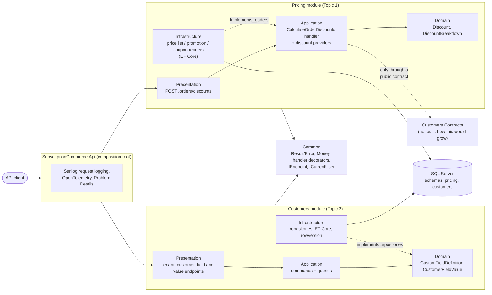
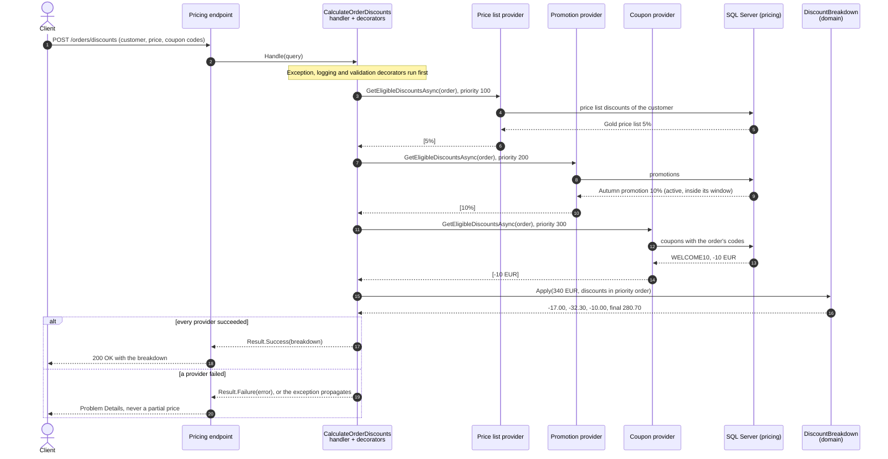
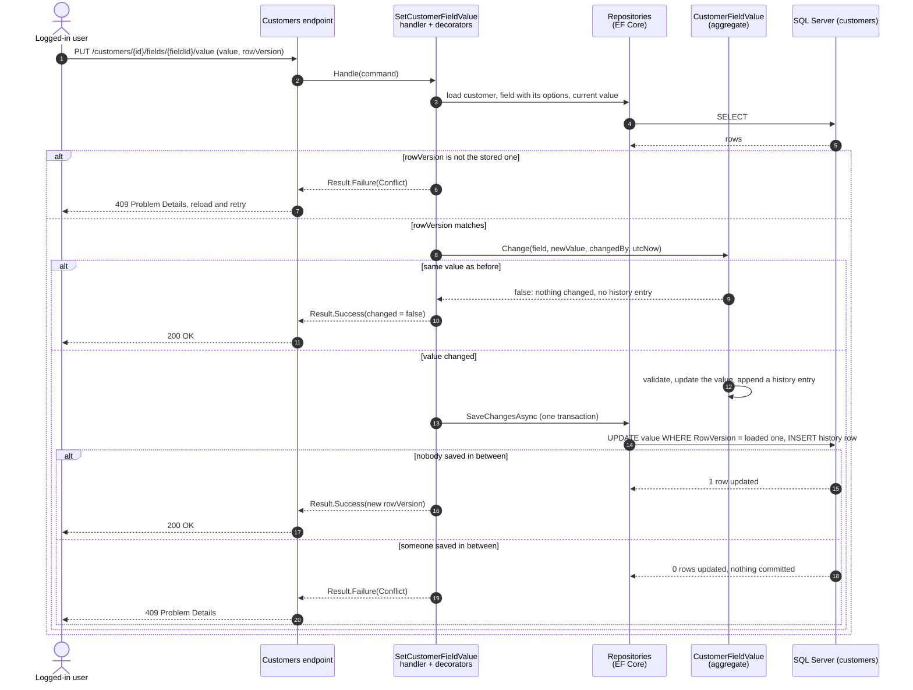
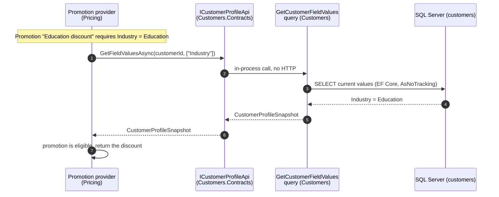
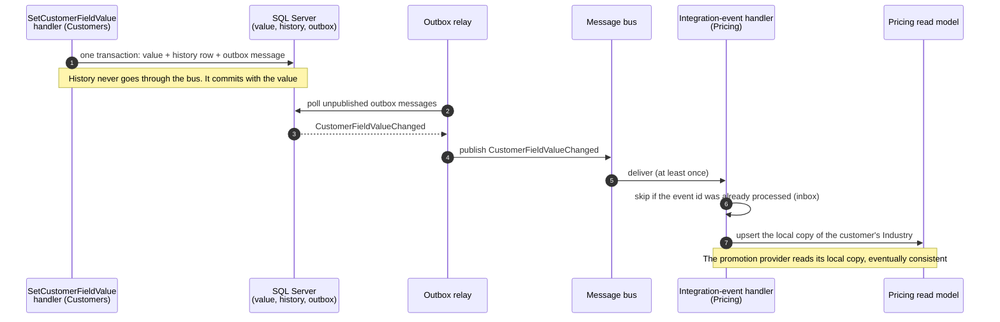

# Module communication flows

The solution is a modular monolith with two modules: **Pricing** (Topic 1, discount engine) and **Customers** (Topic 2, dynamic fields). Each module owns its SQL Server schema and its own layers. The modules never reference each other; architecture tests in `test/SubscriptionCommerce.ArchitectureTests` fail the build if they do.

## 1. Module overview

Requests enter through the API host, which maps each module's endpoints. Inside a module, dependencies point inward: endpoints call application handlers, handlers use the domain, and infrastructure implements the data access defined further in. The only allowed path between modules would be a public contract project such as `Customers.Contracts`. The brief doesn't need the modules to talk, so that project does not exist; flow 4 shows how it would be added.

## 2. Calculate discounts (inside Pricing)

Providers run one after another in priority order. Each provider owns its eligibility rules; the readers only fetch rows. The domain `DiscountBreakdown` applies the discounts to the running price without any I/O, so the arithmetic is fully unit-tested.

## 3. Set a customer field value (inside Customers)

The aggregate decides whether anything changed. Only a real change produces a history entry, and the value and its history row commit in the same `SaveChanges`. The row version is checked twice: against the caller's copy before anything is written, and by SQL Server in the `UPDATE`, which catches a writer that saved between our read and our write. A first value has no row version yet; two simultaneous first values meet the unique index on `(CustomerId, FieldDefinitionId)` and the loser also gets 409.

## 4. Cross-module: how this would grow

Example rule: an "Education discount" promotion applies only to customers whose custom field `Industry` is `Education`. Pricing then needs data owned by Customers. There are two ways to get it.

### 4a. Synchronous, through a public contract (recommended inside one process)

Always up to date and simple. Pricing would reference only `Customers.Contracts`, and the architecture test would allow exactly that project. The cost is that Pricing depends on Customers at calculation time, which is acceptable in one process and one database.

### 4b. Asynchronous, through an integration event (if Pricing were deployed separately)

Pricing keeps its own copy and keeps working when Customers is down, but the copy is eventually consistent and there are more moving parts. This is the outbox/inbox setup the evently reference uses; it was left out here because nothing needs it yet.

| | 4a. Sync public contract | 4b. Async integration event |
|---|---|---|
| Freshness | Always current | Eventually consistent |
| Coupling | Pricing needs Customers at runtime | Pricing works if Customers is down |
| Moving parts | One interface | Outbox, relay, bus, inbox, read model |
| When to choose | Modules share a process and database | Modules are deployed separately |
